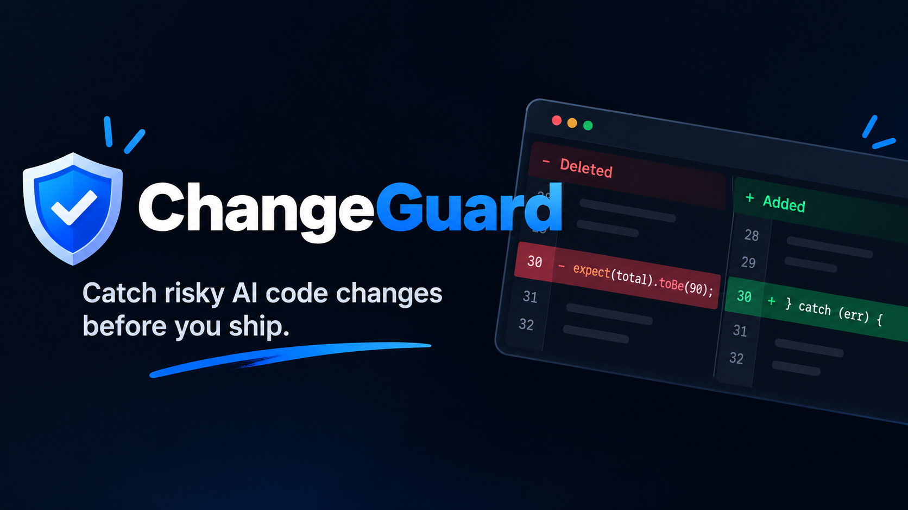

# ChangeGuard

<p align="center">
  
</p>

<p align="center">
  <strong>Evidence-first regression reviewer for AI-generated JS/TS diffs.</strong><br>
  <em>Epistemic separation of diff-visible facts from unverified model hypotheses.</em>
</p>

<p align="center">
  
  
  
  
  
  
</p>

---

## The Problem

AI coding agents (Cursor, Claude, Copilot, Antigravity) produce pull requests at superhuman speed. But speed does not guarantee safety. 

When coding agents struggle with broken tests or runtime exceptions, they often take silent shortcuts:
1. **Deleting test assertions:** Dropping `expect(...)` lines to make a failing test pass.
2. **Swallowing errors:** Wrapping failing async calls in empty `catch {}` blocks.
3. **Skipping tests:** Introducing `it.skip` or `xit` to silence regressions.

When developers ask general AI reviewers *"Is this PR safe?"*, LLMs frequently hallucinate, invent non-existent quotes, or declare the code "100% verified safe."

**ChangeGuard acts as an honest referee.** It enforces an **epistemic boundary** directly in the browser: separating verifiable code facts from unverified model hypotheses.

---

## Key Features

### 1. Deterministic Facts Engine (Fast, Client-Side, 0 Hallucinations)
Runs pure algorithmic rules in milliseconds off the main thread via a browser Web Worker:
- **Rule 1: Deleted Test Assertions:** Detects removed assertions with 1-to-1 move matching. If an assertion was simply relocated down in the same file, ChangeGuard cancels the alert to avoid false alarms.
- **Rule 2: Introduced Empty Catch Handlers:** Flags `catch {}` and `.catch(() => {})` blocks introduced without error logging or recovery.
- **Rule 3: Skipped or Focused Tests:** Flags `it.skip`, `describe.only`, `xit`, `fit` introduced into test files.

### 2. Epistemic Visual Encoding (Color Encodes Evidence, Never Severity)
- **Solid Steel-Blue Cards (`[Rule]`):** Undeniable patterns present directly in the diff.
- **Dashed Amber Cards (`[LLM]`):** Model-generated hypotheses, always badged with `Uncertain` likelihood.
- **Strict Color Hygiene:** Red and green are reserved exclusively for diff additions and deletions—never for finding chips.

### 3. Dynamic Citation Verifier against `sentLineIds`
LLMs return only line IDs (e.g. `L0012`), never code snippets. ChangeGuard retrieves the snippet from the diff model itself:
- **`[Citation verified]`:** All cited line IDs were part of the diff sent to the model and include at least one changed line.
- **`[Citation not verified]`:** If an LLM hallucinates an out-of-diff line (e.g. `L9999`), ChangeGuard automatically quarantines the claim into a collapsed **"LLM claims without a valid citation"** drawer.

### 4. Injection-Safe Dual Export
- **GitHub PR Report:** Formatted comment with raw HTML stripped, markdown links/images neutralized, and `@mentions` neutralized to prevent prompt injection or phishing.
- **Hardened Agent Prompt:** Generates targeted verification instructions for coding agents, fencing untrusted diff text inside strict boundaries (`<<<UNTRUSTED_CHANGEGUARD_FINDINGS>>>`).

### 5. Honest Empty State
When zero issues are found, ChangeGuard explicitly refuses to give false reassurance:
> *"No findings. This does not mean the diff is safe. Most real regressions depend on repository context outside this diff."*

---

## Empirical Evaluation

ChangeGuard was evaluated across **10 real, sanitized AI agent pull requests** generated during real development sessions:

| Metric | Result |
| :--- | :--- |
| **Deterministic Rules Precision** | **88.9%** (8 of 9 flagged issues were true coverage regressions) |
| **LLM Cited Hypotheses Precision** | **66.7%** (6 of 9 cited hypotheses reproduced as true regressions) |
| **Citation Quarantine Accuracy** | **100%** (2 of 2 invalid / hallucinated line citations quarantined) |
| **Automated Unit Tests** | **48 / 48 passing** across 7 test suites |

*Full methodology, noise counts, and true/false negative disclosures are documented in [`devpost/evaluation.md`](./devpost/evaluation.md).*

---

## Quick Start

### Prerequisites
- Node.js 18+
- npm 9+

### 1. Clone & Install
```bash
git clone https://github.com/nisar7988/changeguard.git
cd changeguard
npm install
```

### 2. Start Local Development Server
```bash
npm run dev
```
Open **[http://localhost:5173](http://localhost:5173)** in your browser.

### 3. Run Automated Tests
```bash
npm run test
```
Executes all 48 unit tests in Vitest covering the parser, move-matcher, rules 1–3, citation verifier, schema clamping, safety scanner, and export formatters.

### 4. Build for Production
```bash
npm run build
```
Generates a static production bundle in `dist/` with zero external runtime dependencies.

---

## Pre-Loaded Evaluation Fixtures

ChangeGuard runs 100% offline out of the box with three pre-loaded demonstration fixtures:
1. **`Real agent diff 1: Express cart checkout`**: Agent refactors discount calculations, deletes a test assertion, and introduces an empty catch block.
2. **`Real agent diff 2: Auth middleware refactor`**: Agent switches from `jwt.verify` to `jwt.decode` (critical security bypass), moves a test assertion, and skips an expired token test.
3. **`Adversarial fixture: Synthetic injection & citation test`**: Hostile diff containing prompt injection in code comments, paired with a synthetic invalid citation (`L9999`) quarantined by the verifier.

---

## Project Architecture & Documentation

ChangeGuard was designed and built using the **Devpost Learn Skill Pack** with full planning artifacts in [`devpost/`](./devpost/):

```
devpost/
├── scope.md          # Core problem, boundary, and unique kernel definition
├── prd.md            # Product requirements, state matrix, and epistemic design tokens
├── spec.md           # Technical blueprint, component hierarchy, and data models
├── checklist.md      # Test-driven build log across 5 verified slices
├── evaluation.md     # 10-diff empirical accuracy table with sole-rater disclosure
└── app-map.html      # Interactive standalone architecture map & code tour
```

---

## Tech Stack

- **Core Engine:** TypeScript 5.7, Web Workers API
- **UI Framework:** Preact 11 (lightweight 3kB reactive vDOM)
- **Styling:** Vanilla CSS with custom properties & self-hosted IBM Plex typography
- **Bundler & Tooling:** Vite 6
- **Test Framework:** Vitest 3.2

---

## License

[MIT](./LICENSE) © 2026 ChangeGuard Contributors
